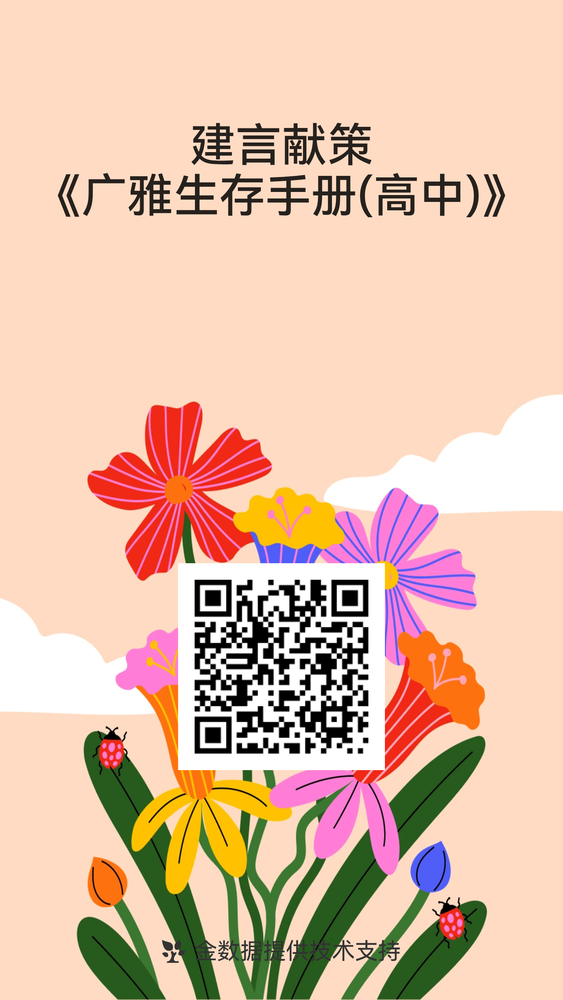

目前来说，这个项目是挂在 GitHub 上的，地址为 <https://github.com/druvis1023/GY-Guide.git>，所有人都可以参与编写，贡献自己的一份力量。

写这个，主要是为了广雅的学弟学妹们能够更好地了解广雅。这本书的内容**仅供参考**，毕竟每个年级的制度会根据级长的要求而有所不同，比如说 24 级晚修只需 19 点到班，而 25 级的级长 18:40 左右就在走廊守人……毕竟他们 18:50 开始晚修。

这本《广雅生存手册（高中）》仅仅适用于花都校区，并且**不是广雅官方写的**，而是一群想要把自己的一些踩过的坑、碰到的雷让学弟学妹避开的同学们一起编写的，因此也会比官方更敢说。不仅如此，还会教授一些小秘密。

如果你也有一些想要学弟学妹避雷、或者有意思的内容想要分享，欢迎填写问卷 [https://jsj.top/f/Y4QEkd](https://jsj.top/f/Y4QEkd)、在 GitHub 提交 Issue，或者直接发邮件给本文主要执笔者 [druvis1023@hotmail.com](mailto:druvis1023@hotmail.com)，来为这本手册添砖加瓦！

*图：问卷二维码*

## 开学清单

如果你是第一次住宿，或者说准备开学了，那么这里会告诉你需要准备什么。

### 生活用品

- 行李箱、书包
- 梳子（选带）、镜子（选带）、发夹 & 发圈（选带）
- 衣架、毛巾、卫生纸、卫生巾（选带）
- 伞、水杯、夹子
- 洗面奶（选带）、沐浴露/香皂、洗发水、护发素（选带）、洗衣液
- 灯（选带）
- 牙膏、牙刷、刷牙杯
- 盆 + 桶

### 床上用品

- 床上四件套（床单、被套、枕套）
- 床垫、枕头、被子
- 蚊帐
- 凉席（选带）

### 衣物

- 校服短袖（两套及以上）
- 短裤（按需带）、长裤（按需带）、外套（按需带）
- 班服（选带）
- 袜子、内衣裤、拖鞋

### 文具 & 书籍

- 笔袋 / 笔盒
- 黑、蓝、红笔，2B 铅笔，橡皮，荧光笔
- 订书机 + 订书钉（非必要）
- 笔记本、便利贴、试卷夹、文件袋（选带）
- 胶带（双面胶/透明胶）（非必要）
- 书袋、名著、作业、练习册、全解（非必要）

有了这个清单，收拾东西应该不会有遗漏了吧（笑），希望能过得愉快。
